# Collections

A collection is a layout that lists other notes: a shelf of books, a map of
places, a journal. Put `layout:` on the note that holds the list, usually a
folder note, and give the listed notes the properties the collection reads.
[Page layouts](layouts.md) lists every collection with the frame it picks,
and [Layouts of a note's own text](layouts-text.md) covers the layouts that
lay out a single note.

Every example below is also a live page of this documentation; follow its
link, then compare with its source on
[GitLab](https://gitlab.com/dynamo-brain/datme/-/tree/main/docs/examples).

## Which notes, in which groups

A collection lists the notes in its note's folder, or the folders and
`#tags` given in `from` (questions and digests have their own defaults,
below). Protected and unlisted notes are never listed.

| Property | What it does |
| --- | --- |
| `from` | Folders and `#tags` to list, one or a list: `from: "#game"`, `from: [Reading, "#book"]` |
| `group` | The property to group by, `year`, `month`, or `none`; alternatives joined by `\|`, such as `season\|year` |
| `fields` | The properties shown under each title |

Projects, books and movies are grouped by `status`: projects go in progress,
planned, paused, done, archived; books go reading, to read, read, abandoned;
movies go watching, to watch, watched, abandoned. Usual spellings of each
status count (`ongoing`, `completed`, `want-to-read`, `dnf`, `watchlist`,
`seen`, …). Any other status gets its own group after these, and notes
without one come last.

When a collection's note embeds a base (`![[Reading.base]]`, a view of one,
or a ```` ```base ```` block), it lists what the base finds instead, in the
base's order and under its `groupBy` groups, and the base's own table is
left out. In a `gallery`, a base shows the covers of the notes it finds; in
a `timeline`, those notes at their dates.

A folder note with a `layout` lays out its folder's page as well:
`Projects/Projects.md` with `layout: projects` turns `/Projects` into the
projects page.

## The listed notes' own pages

A note listed by a collection shows its `cover` beside its title, with what
it is (author, years, date and event…), its status, rating and links. A
person's page shows their face round, an episode's its player, a course's
its progress and certificate, and a question's whether it is answered. A
recipe's page puts its ingredients (a section named *Ingredients* or
*Nguyên liệu*) beside its steps, each one to tick off. Any note with a
`cover` gets the same head.

```markdown
---
tags: [book]
status: read
author: "[[Cal Newport]]"
rating: 4
cover: deep-work.jpg
---
```

## projects

A card for each project, grouped by `status`.

| Property of a listed note | What it does |
| --- | --- |
| `cover`, `description` | The picture and the line of the card |
| `start`, `end` | The years it ran |
| `role` | What you did |
| `stack` (or `tech`) | What it is built with |
| `repo`, `url`, `demo`, `links` | Links on the card |

```markdown
---
status: in progress
start: 2025-03-01
stack: [TypeScript, Astro]
repo: https://github.com/example/garden
description: A digital garden, grown from an Obsidian vault.
---
```

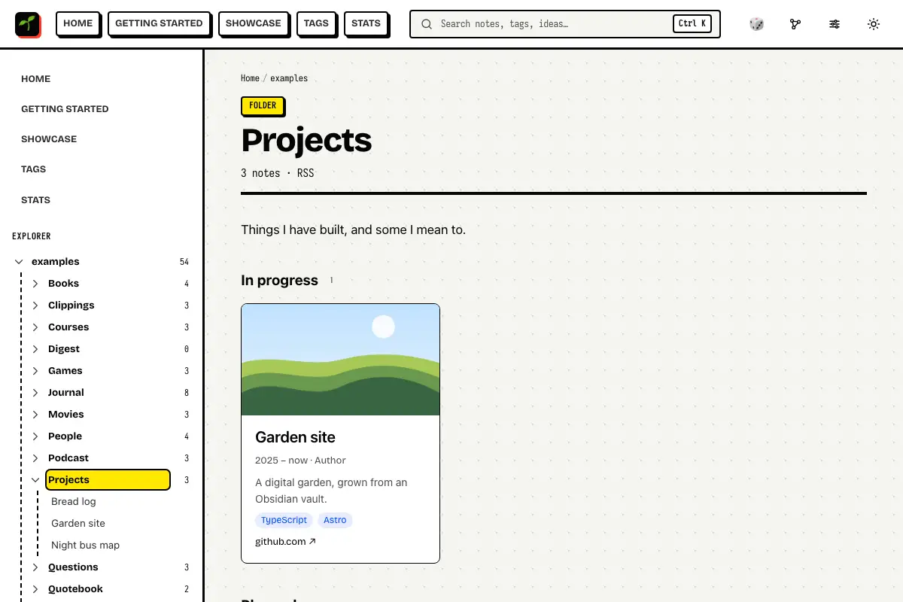

*Live example: [Projects](examples/Projects/Projects.md).*

## books

A shelf of covers, grouped by `status`.

| Property of a listed note | What it does |
| --- | --- |
| `cover` | The book's cover |
| `author`, `year` | Under the title |
| `rating` | Out of five, or of `conventions.ratingScale` |

```markdown
---
status: read
author: Cal Newport
year: 2016
rating: 4
cover: "[[deep-work.jpg]]"
---
```

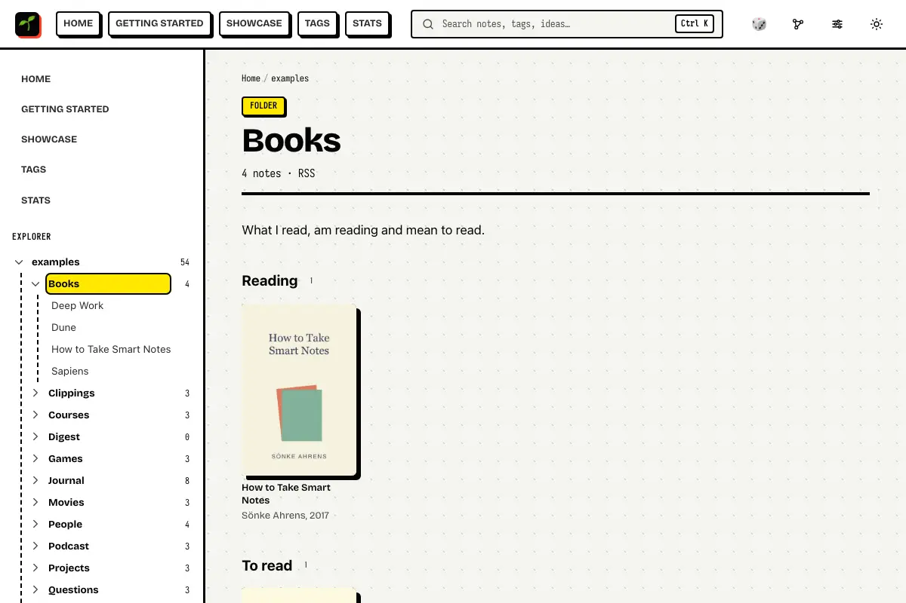

*Live example: [Books](examples/Books/Books.md).*

## movies

A shelf of posters, grouped by `status`.

| Property of a listed note | What it does |
| --- | --- |
| `cover` | The poster |
| `director`, `released` (or `year`) | Under the title |
| `rating` | As for books |

```markdown
---
status: watched
director: Andrei Tarkovsky
released: 1979
rating: 5
---
```

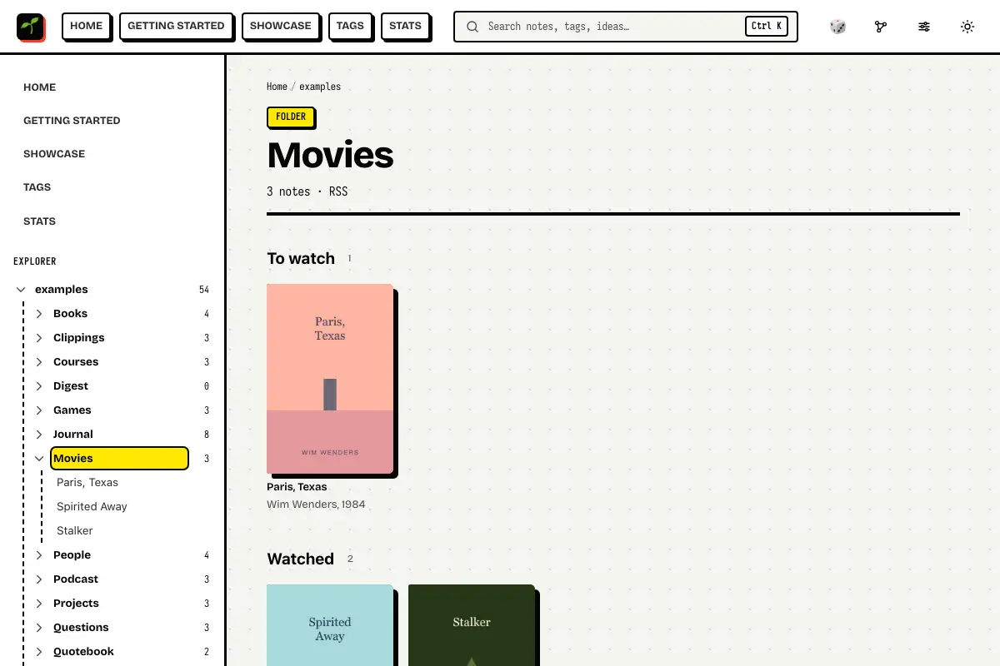

*Live example: [Movies](examples/Movies/Movies.md).*

## talks

A row for each talk, grouped by year.

| Property of a listed note | What it does |
| --- | --- |
| `date` | When it was given |
| `event` (or `venue`) | Where |
| `slides`, `video`, `paper` | Links on the row |

```markdown
---
date: 2026-09-10
event: Notes Conf
slides: https://slides.example/gardens
---
```

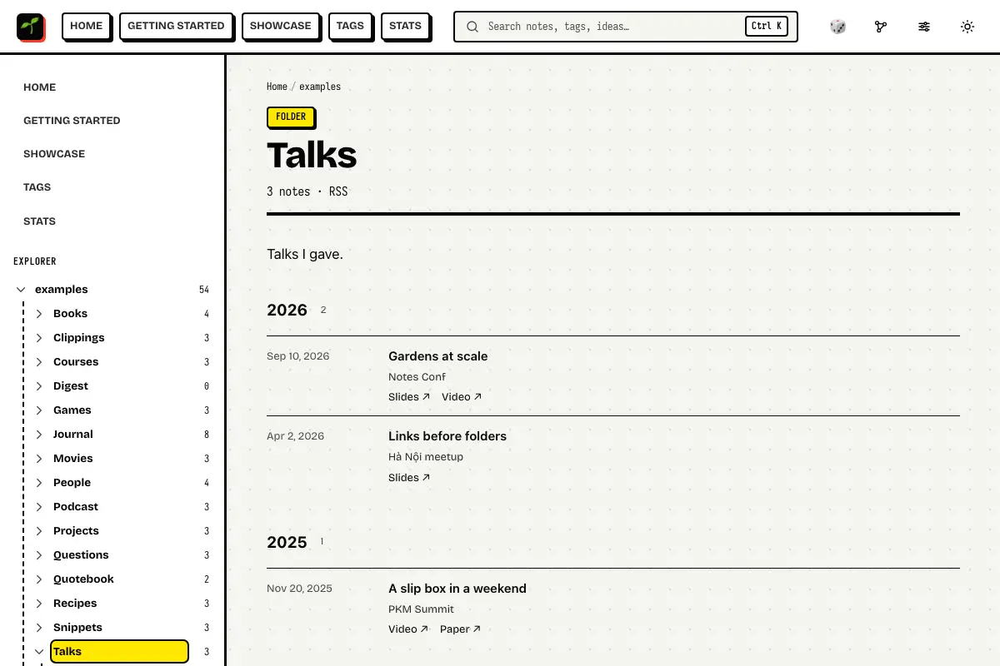

*Live example: [Talks](examples/Talks/Talks.md).*

## recipes

A card for each recipe, grouped by `category`.

| Property of a listed note | What it does |
| --- | --- |
| `cover` | The picture of the dish |
| `time`, `servings` | On the card |
| `category` | The group |

```markdown
---
category: Soups
time: 6 h
servings: 6
cover: "[[pho.jpg]]"
---
```

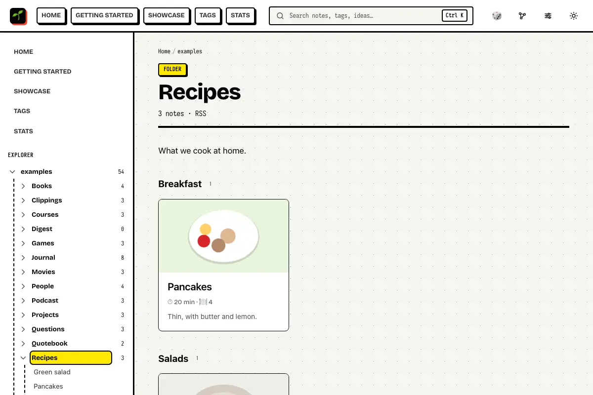

*Live example: [Recipes](examples/Recipes/Recipes.md).*

## places

A map of the places with a `location`, over a card for each, grouped by
`country`.

| Property of a listed note | What it does |
| --- | --- |
| `location` | `[lat, lng]`, its marker on the map |
| `country` | The group |
| `cover` | The picture of the card |

```markdown
---
country: Vietnam
location: [22.34, 103.84]
cover: "[[terraces.jpg]]"
---
```

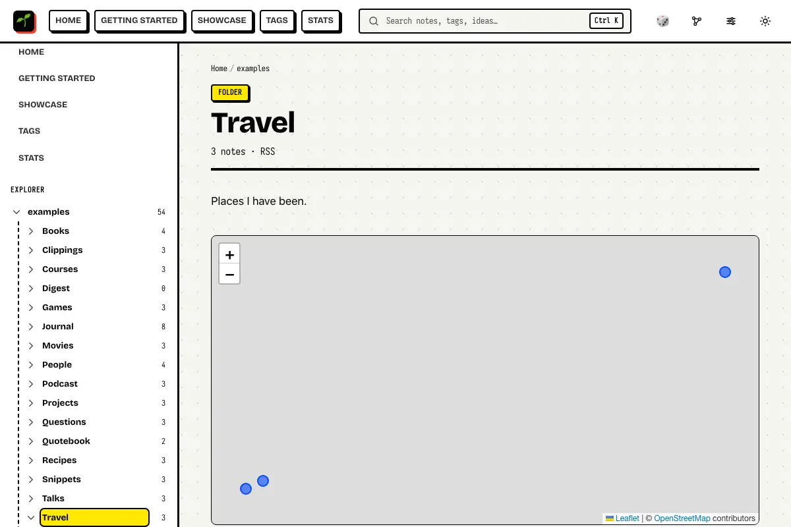

*Live example: [Travel](examples/Travel/Travel.md).*

## daily

A journal. A calendar of the year marks each day with a note (click one to
open it), each numeric property named in `track` is drawn as a small chart
over time, with its numbers as a table for screen readers and paper, and the
latest entries follow, grouped by month. A day is the note's `date`, else its
name in the vault's daily note format, as on `/calendar`, or a name starting
with `YYYY-MM-DD`. A day keeps its usual page, with its links to the days
before and after.

| Property | What it does |
| --- | --- |
| `track` | On the collection: the numeric properties to chart, `track: [mood, sleep, pages]` |
| `limit` | On the collection: how many entries to list, 30 by default |
| `date` | On a day: the day, when its name does not say |

```markdown
---
layout: daily
track: [mood, sleep]
---
```

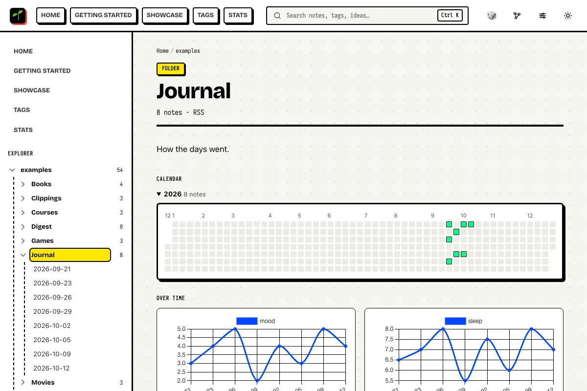

*Live example: [Journal](examples/Journal/Journal.md).*

## bookmarks

A reading list of clipped pages, as the Obsidian Web Clipper saves them: the
site of the page with its logo, or its first letter for a site datme has no
logo for (no favicon is fetched), then its author and date and the note's own
first paragraph as your comment. Grouped by `status`: unread, read, archived
(`to-read`, `inbox`, `later`, `done`, `archive`, …); `group: month` lists
them by the month they were clipped (their `created` date).

| Property of a listed note | What it does |
| --- | --- |
| `source` (or `url`) | The page clipped |
| `author`, `published` | Under the title |
| `status` | The group |

```markdown
---
source: https://notes.andymatuschak.org/Evergreen_notes
author: Andy Matuschak
status: to-read
---

Notes that keep growing, linked to each other.
```

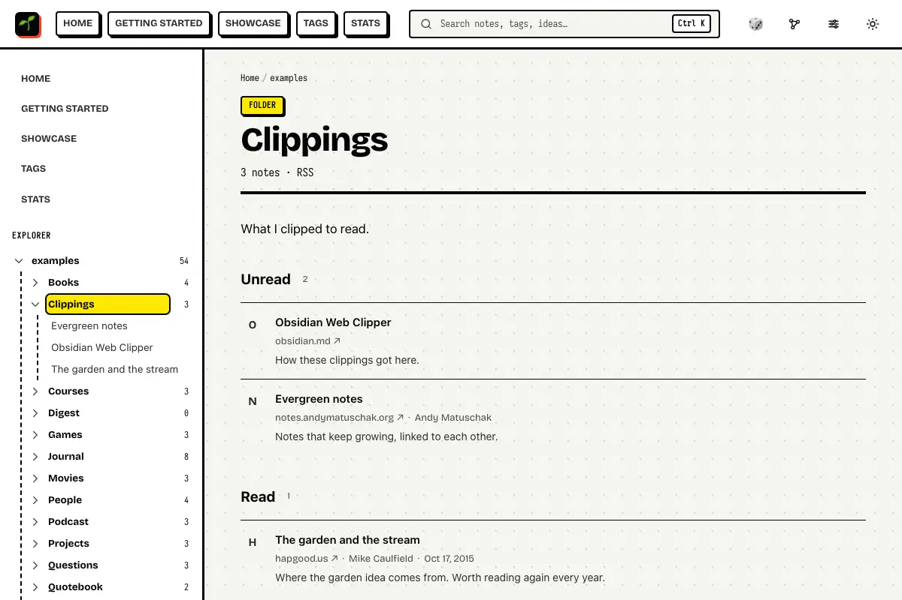

*Live example: [Clippings](examples/Clippings/Clippings.md).*

## people

A grid of faces, with initials for anyone without one, sorted by name.
Below, a graph of how the people link to each other, with the same ties as a
list.

| Property of a listed note | What it does |
| --- | --- |
| `avatar` (or `cover`) | The face |
| `role`, `org` (or `company`) | Under the name |
| `website`, `url`, `links` | Links |

```markdown
---
avatar: "[[ada.jpg]]"
role: Mathematician
org: Analytical Engine
---

Wrote the first program, with [[Charles Babbage]] in mind.
```

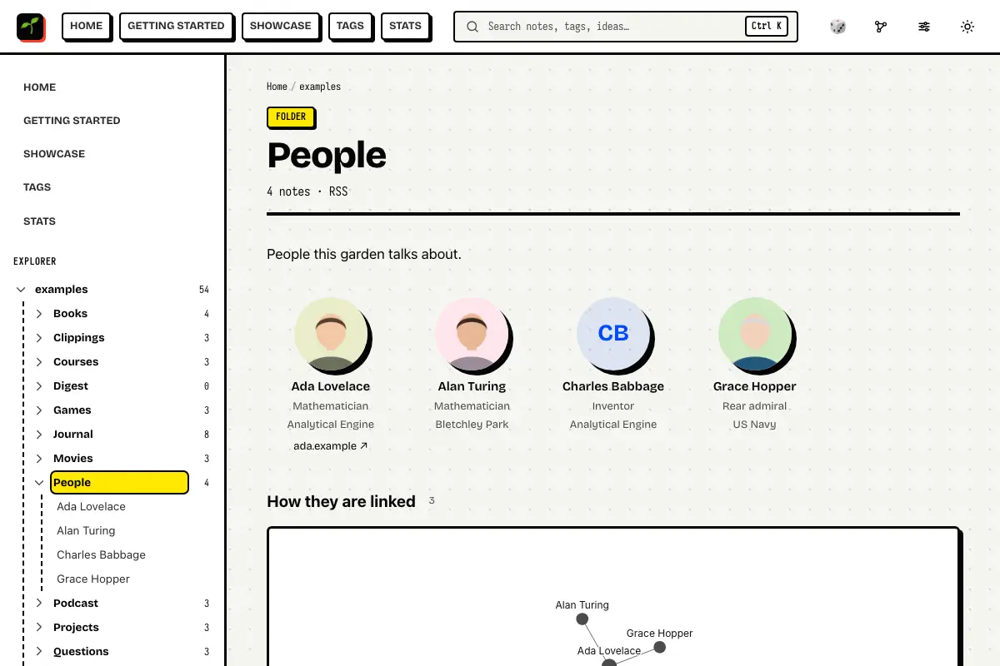

*Live example: [People](examples/People/People.md).*

## snippets

Code snippets or things learned. Each note is a card with its first code
block, highlighted and with a copy button, and its language as a badge;
buttons above filter the cards by language.

| Property of a listed note | What it does |
| --- | --- |
| `language` | The badge, else the code block's language |

````markdown
Reverse a list without changing it.

```ts
const reversed = [...items].reverse()
```
````

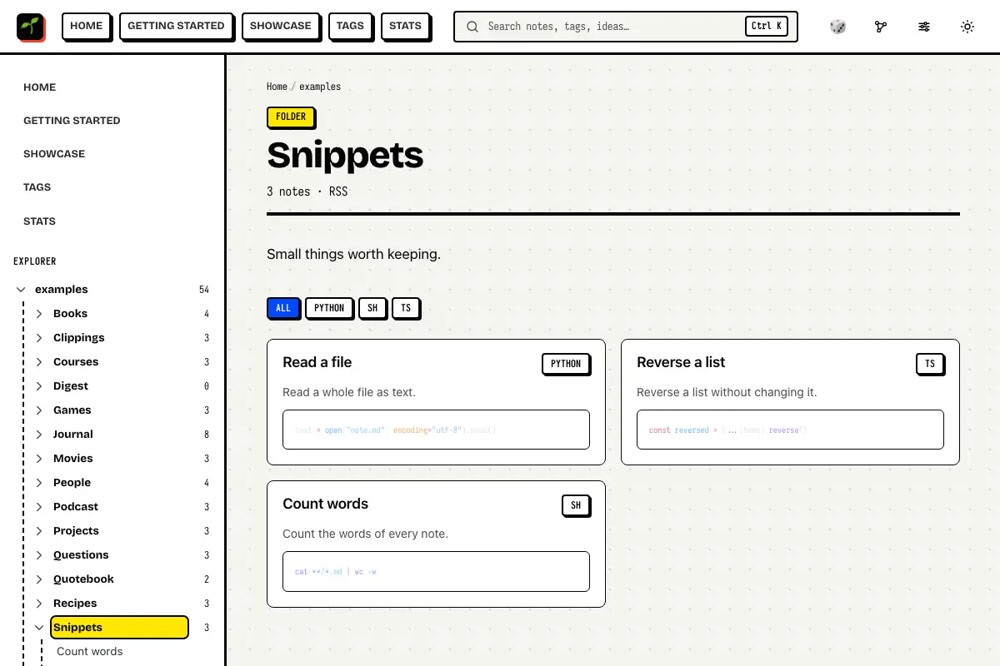

*Live example: [Snippets](examples/Snippets/Snippets.md).*

## episodes

A podcast or a newsletter. Each issue is a row with a player for its audio,
newest first and grouped by `season`, else by year. The collection has a
podcast feed next to its page (`episodes.xml`), each `audio` as an enclosure
that podcast apps can play; a sound elsewhere on the web is listed with an
unknown length (0).

| Property of a listed note | What it does |
| --- | --- |
| `number` (or `episode`) | The issue's number |
| `date`, `duration`, `guests` | On the row |
| `audio` | A file of the vault or a URL |
| `season` | The group |

```markdown
---
number: 1
season: 1
date: 2026-08-10
duration: "32:10"
audio: "[[pilot.mp3]]"
guests: ["[[Ada Lovelace]]"]
---
```

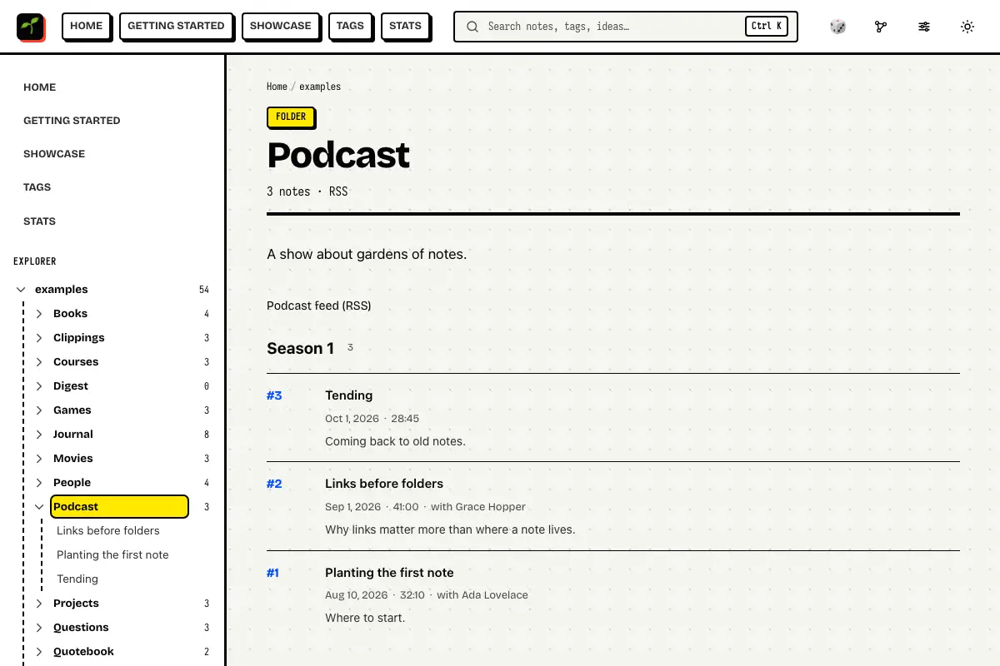

*Live example: [Podcast](examples/Podcast/Podcast.md).*

## courses

Courses you took, take or mean to take, grouped by `status`: in progress,
planned, completed, dropped (`doing`, `enrolled`, `todo`, `finished`,
`passed`, `quit`, …). A course's own page shows the same bar and link.

| Property of a listed note | What it does |
| --- | --- |
| `provider` (or `platform`), `instructor` | Who teaches it |
| `start`, `end` | The years |
| `progress` | A bar: `45`, `45%` or `3/10` |
| `certificate` | A URL, or a file of the vault (`certificate: "[[cert.pdf]]"`), which is then published |

```markdown
---
status: in progress
provider: Coursera
progress: 6/10
start: 2026-08-10
---
```

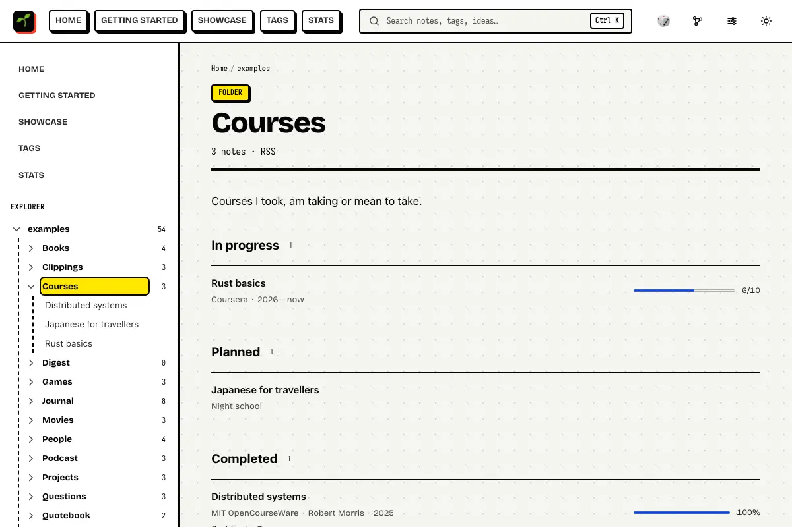

*Live example: [Courses](examples/Courses/Courses.md).*

## wishlist

Things you would like to get, grouped by `status`: wanted, bought, gifted,
dropped (`want`, `to-buy`, `got`, `purchased`, `gift`, `skipped`, …), each
group with what its wishes cost together. The most wanted come first. A
bought item can link to where it is in use, such as your `uses` page, with an
ordinary link.

| Property of a listed note | What it does |
| --- | --- |
| `price` | Written as the note's language writes money in its `currency` |
| `currency` | An ISO code such as `USD`, else the sign in the price, `$12` |
| `priority` | `high`, `medium`, `low` or `1`, `2`, `3` |
| `url` | Where to get it |

```markdown
---
status: wanted
price: 149
currency: USD
priority: high
url: https://shop.example/keyboard
---
```

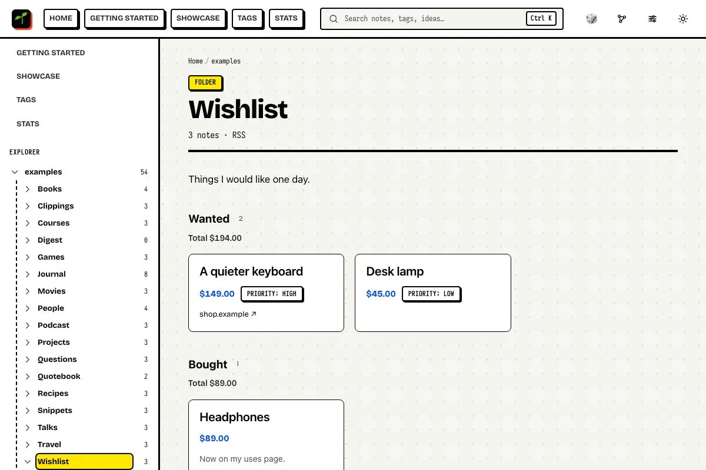

*Live example: [Wishlist](examples/Wishlist/Wishlist.md).*

## quotebook

Every quote of the listed notes, on one page. A quote is a `>` blockquote
whose last line names who said it (`— Ada Lovelace`), as in the
[`quotes`](layouts-text.md#quotes) layout; unsigned quotes are left out.
Each quote links back to its passage: to its block id when it has one (a
`^id` line after it), else to its first words with a text fragment. Quotes a
note embeds from another, in a protected note or in a locked part are never
gathered. The quoted notes keep their usual page.

| Property | What it does |
| --- | --- |
| `group` | `author` (the default, A–Z), `source` (the note they are in) or `none` |

```markdown
> Simplicity is prerequisite for reliability.
>
> — Edsger Dijkstra
```

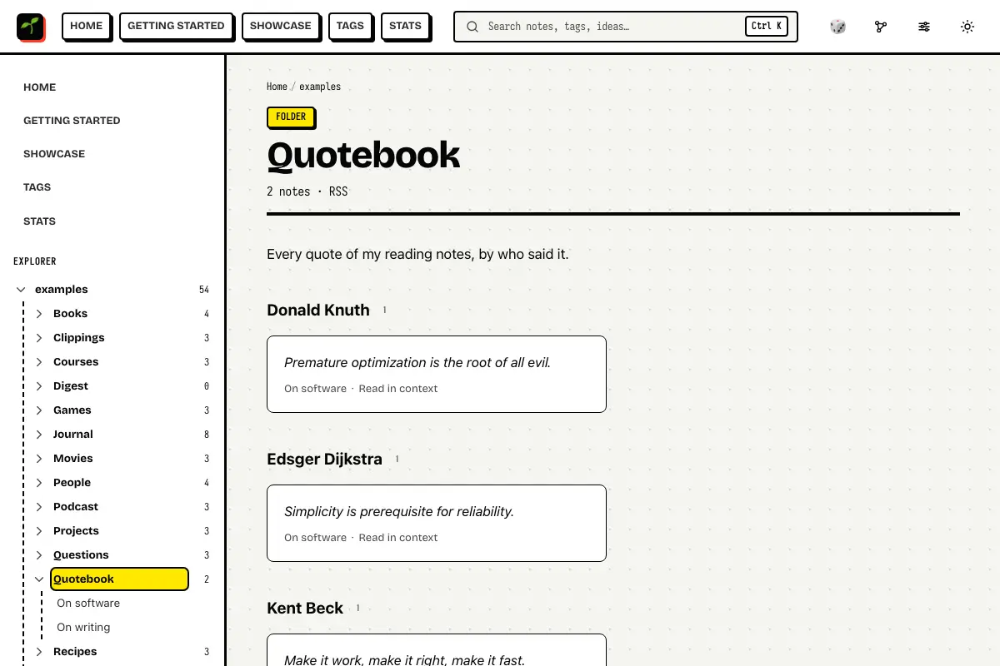

*Live example: [Quotebook](examples/Quotebook/Quotebook.md).*

## questions

Open questions. Lists the notes tagged `#question` (or those of `from`), open
ones first, the oldest first. A question is answered by `status: answered`
(or `resolved`, `solved`, `closed`…), by an `answer` property (a note, a URL
or a few words), or by a link to a note in a section named *Answers*; the
answer is linked from the list and from the question's own page. An answer
that is unlisted, a draft or protected still answers it, without being named.

| Property of a listed note | What it does |
| --- | --- |
| `status` | `answered` and its usual spellings close it |
| `answer` | A note, a URL or a few words |

```markdown
---
tags: [question]
answer: One idea, however long that takes.
---
```

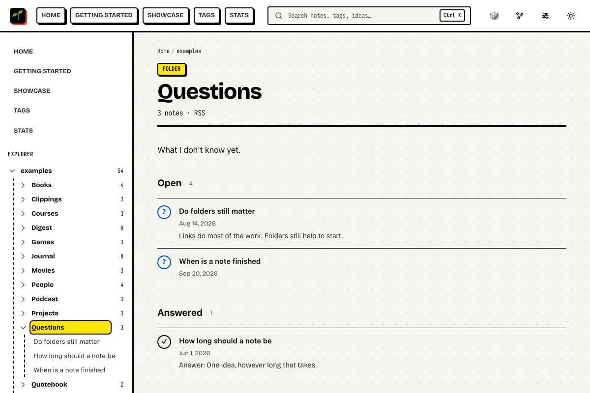

*Live example: [Questions](examples/Questions/Questions.md).*

## digest

A weekly digest of the garden. Each ISO week, newest first, lists the notes
planted (created) and tended (updated) in it. It covers the whole garden, or
the folders and `#tags` of `from`. With `history: true`, and `history` on for
the site, every public version from git counts and links to its history
page, as on the changes page. The weeks also make an RSS feed at
`digest.xml` next to the page, linked from it.

| Property | What it does |
| --- | --- |
| `limit` | How many weeks, 8 by default |
| `history` | `true` to count every public version from git |

```markdown
---
layout: digest
limit: 4
---
```

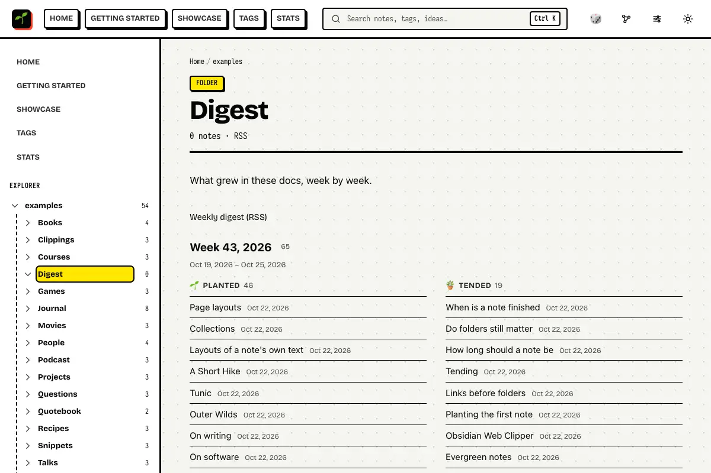

*Live example: [Digest](examples/Digest/Digest.md), over this whole
documentation.*

## shelf

A shelf of anything else: games, records, podcasts. Name its statuses and
the properties to show under each title.

| Property | What it does |
| --- | --- |
| `statuses` | The groups, in order: a name, or one per language |
| `fields` | The properties shown under each title |

```markdown
---
layout: shelf
from: "#game"
statuses:
  playing: { en-US: Playing, vi-VN: Đang chơi }
  backlog: Backlog
fields: [platform, year]
---
```

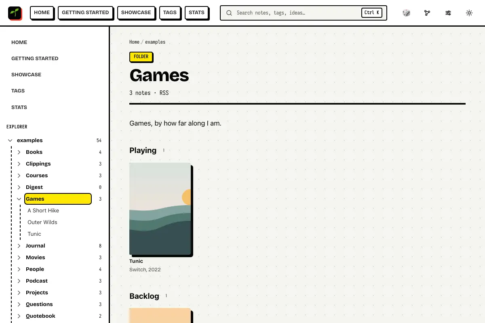

*Live example: [Games](examples/Games/Games.md).*
