# Layouts of a note's own text

These layouts lay out what a note itself holds: its headings, lists, quotes
and properties. Put `layout:` in the note's frontmatter and write the rest as
usual; in Obsidian it stays an ordinary note. [Page layouts](layouts.md)
lists them all with the style and frame each one picks, and
[Collections](collections.md) covers the layouts that list other notes.

Every example below is also a live page of this documentation; follow its
link, then compare with its source on
[GitLab](https://gitlab.com/dynamo-brain/datme/-/tree/main/docs/examples).

## cv

A résumé. The title is your name and the head holds what the properties
give. The text before the first heading is the summary. Each `##` section is
a row with its heading at the side. A button prints the page or saves it as
a PDF.

| Property | What it does |
| --- | --- |
| `role` | The line under your name |
| `location`, `phone`, `email` | Contact details in the head |
| `links` | A map of label to URL, such as `GitHub: https://…` |
| `cover` | Your photo |

```markdown
---
layout: cv
title: Ada Lovelace
role: Analyst of engines
email: ada@example.com
cover: "[[ada.jpg]]"
links:
  GitHub: https://github.com/example
---

Writes programs for machines that do not exist yet.

## Experience

### Translator and annotator, Analytical Engine
1842 – 1843
```

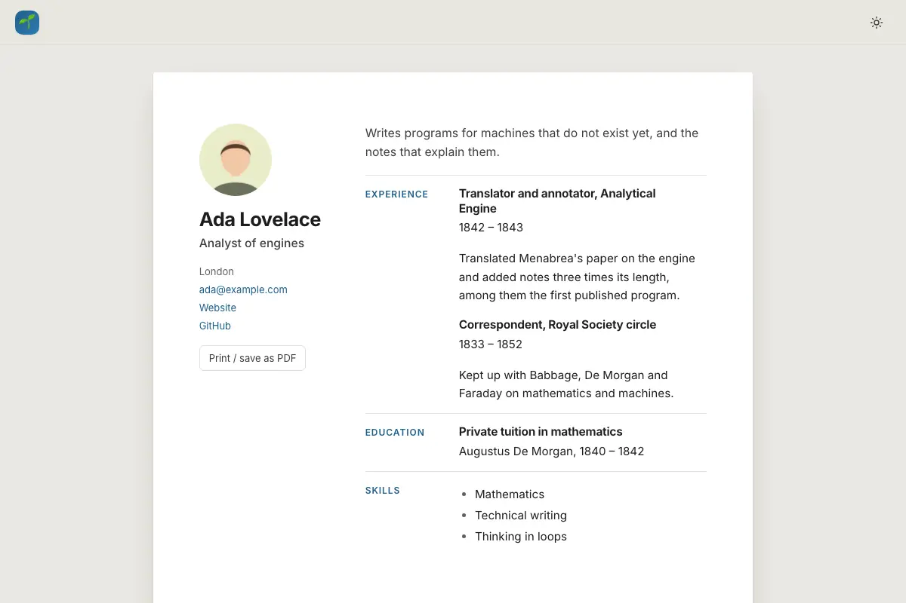

*Live example: [Ada Lovelace](examples/cv.md).*

## gallery

Pictures embedded one after another (`![[a.jpg]]`) become a grid, and
clicking one opens it large. `![[a.jpg|Caption]]` captions a picture. Text
and headings stay as they are, so each heading can start an album. It has no
properties of its own.

```markdown
---
layout: gallery
---

## The hills

![[hills-dawn.jpg|Dawn over the hills]]
![[pine-ridge.jpg|Pine ridge]]
```

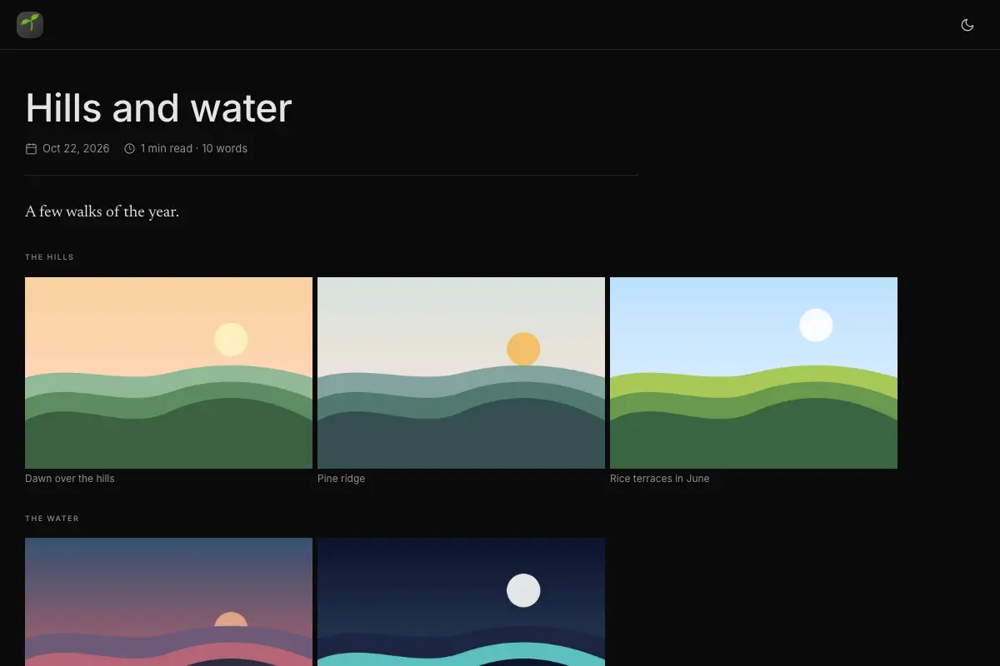

*Live example: [Hills and water](examples/gallery.md).*

## timeline

Each `##` heading is a moment on a line down the page (a year, a date, a
chapter), with its text beside it. It has no properties of its own.

```markdown
---
layout: timeline
---

## 2019

A folder of plain markdown notes.

## 2026

Built with datme.
```

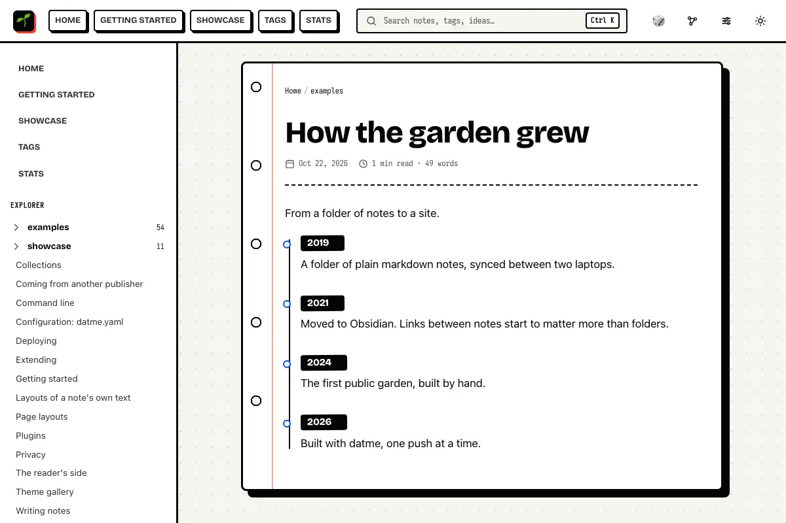

*Live example: [How the garden grew](examples/timeline.md).*

## links

A page of links, as in a link-in-bio. Every list whose items each start with
a link becomes a column of buttons; the words after a link describe it.

| Property | What it does |
| --- | --- |
| `cover` | The avatar |
| `description` | The line under the title |

```markdown
---
layout: links
description: Notes, engines and letters.
cover: "[[ada.jpg]]"
---

- [Website](https://ada.example) — notes and essays
- [[cv|Résumé]] — what I have done
```

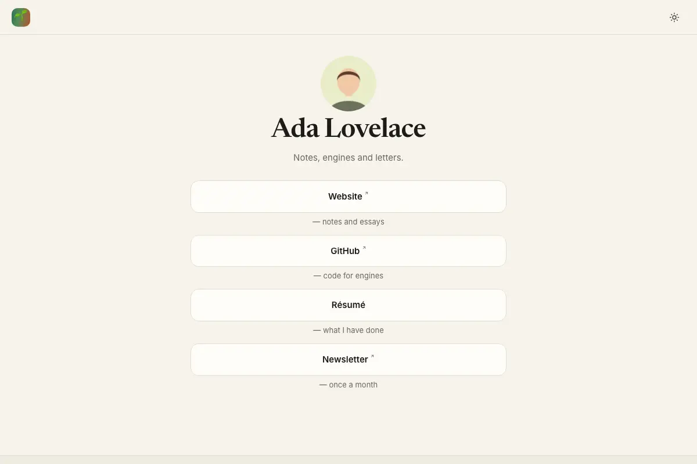

*Live example: [Ada Lovelace](examples/links.md).*

## uses

What you work with. Every list whose items each start with a name in bold
(`- **Vim** — my editor`) or a link becomes a grid of cards. It has no
properties of its own.

```markdown
---
layout: uses
---

## Hardware

- **ThinkPad X1 Carbon** — the daily driver
- **Keychron Q1** — a quiet, heavy keyboard
```

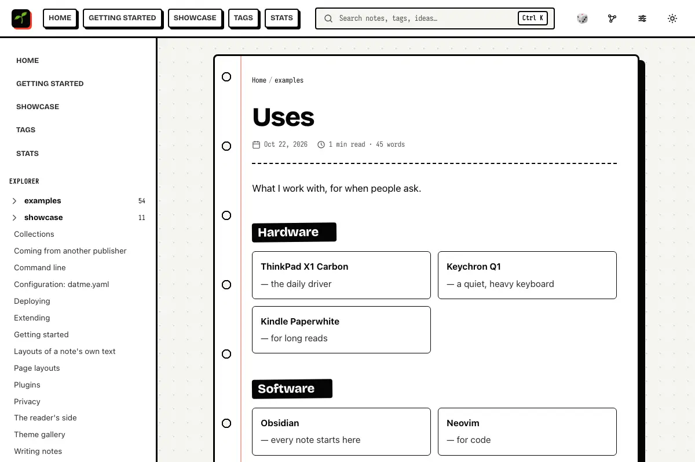

*Live example: [Uses](examples/uses.md).*

## now

What you are doing now. The page says when it was last updated (`updated`,
else the note's history), and warns readers once that is more than three
months ago. With `home: bento`, the latest one is a tile of the home page.

```markdown
---
layout: now
---

- Reading *How to Take Smart Notes*, slowly.
- Learning to bake bread that rises.
```

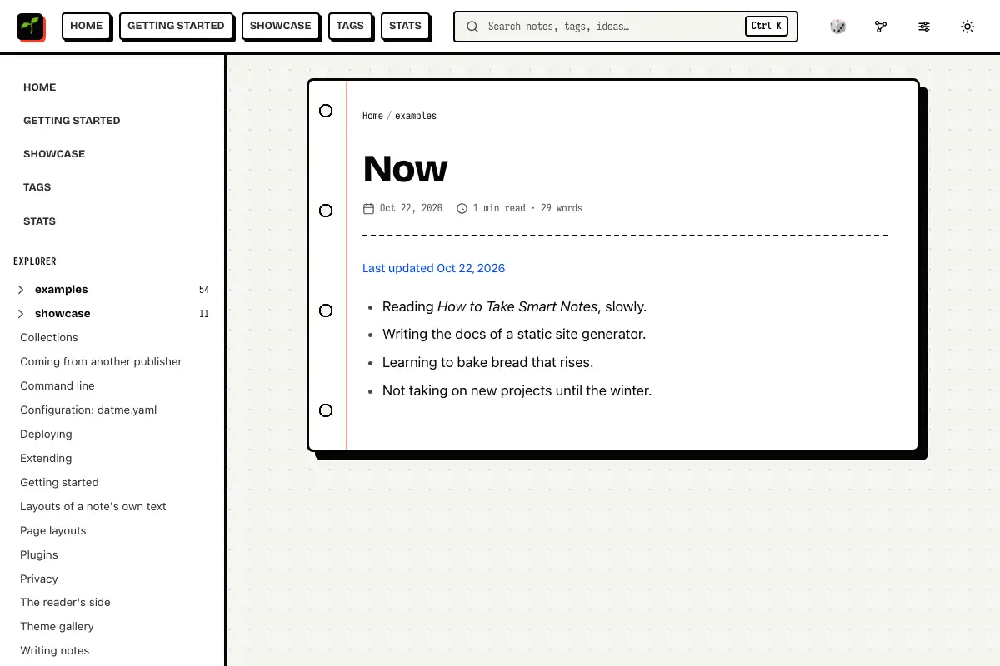

*Live example: [Now](examples/now.md).*

## faq

Each `##` heading is a question that opens on its answer. It has no
properties of its own.

```markdown
---
layout: faq
---

## Why a digital garden and not a blog?

A garden is a set of notes that keep growing.
```

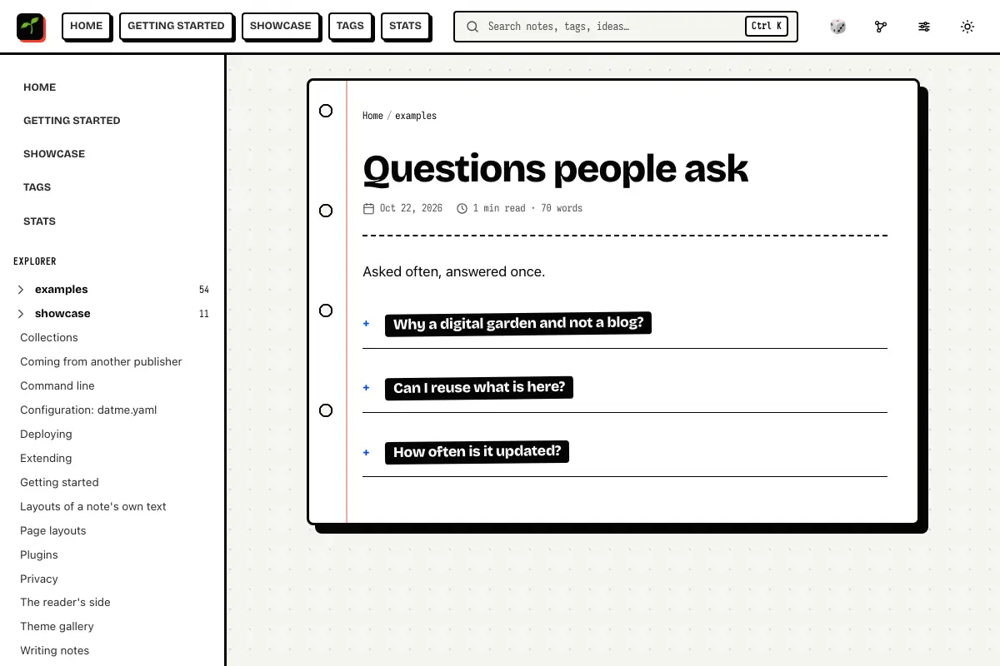

*Live example: [Questions people ask](examples/faq.md).*

## quotes

Quotes (`>`) become a wall of cards. A last line starting with a dash
(`— Ada Lovelace`) is who said it. It has no properties of its own.

```markdown
---
layout: quotes
---

> Simplicity is prerequisite for reliability.
>
> — Edsger Dijkstra
```

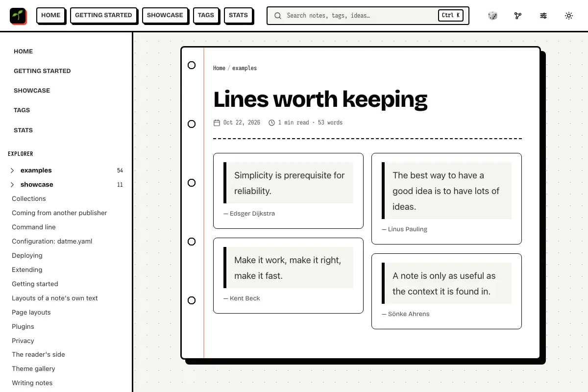

*Live example: [Lines worth keeping](examples/quotes.md).*

## paper

An academic paper. A section named *Abstract*, or else the text before the
first heading, is the abstract, in a box; the rest runs in two columns where
the page is wide enough. A *Cite this* box gives the reference and a BibTeX
entry, built from the properties, to copy.

| Property | What it does |
| --- | --- |
| `authors` | A list; wikilinks link to their notes |
| `affiliation` (or `affiliations`) | Where the authors work |
| `journal` or `conference`, `volume`, `issue`, `pages` | Where it appeared |
| `doi`, `arxiv` | Links to the paper |

```markdown
---
layout: paper
title: Gardens of Notes at Scale
authors: ["[[Ada Lovelace]]", Charles Babbage]
journal: Journal of Note Taking
doi: https://doi.org/10.1234/notes.2026
---

## Abstract

We study how a garden of notes grows when it is tended for years.
```

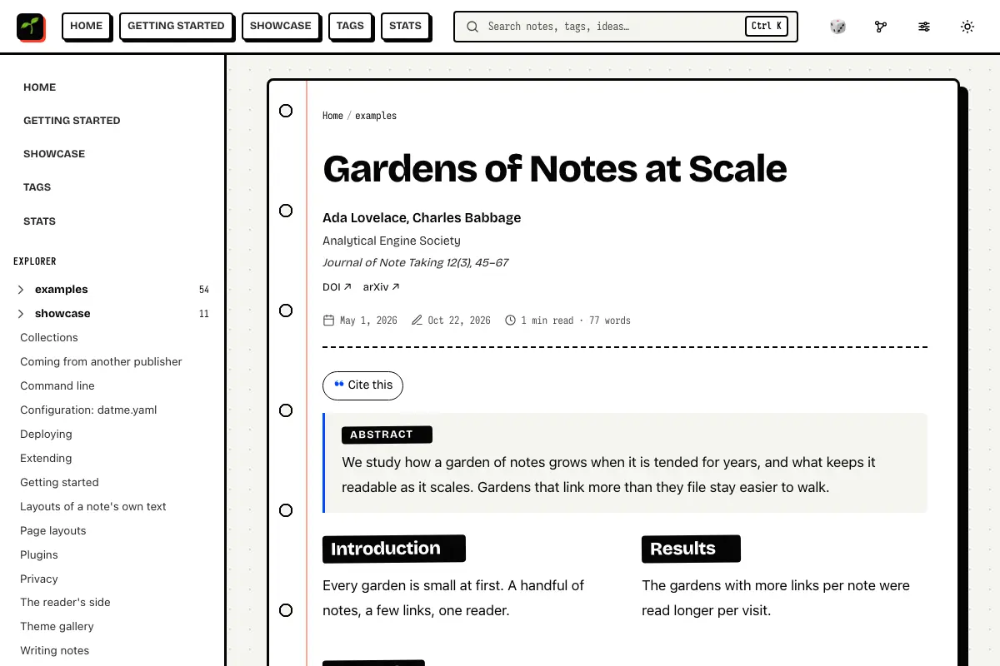

*Live example: [Gardens of Notes at Scale](examples/paper.md).*

## decision

An architecture decision record. Sections named *Context*, *Options* (or
*Considered options*), *Decision* and *Consequences* each get a look of their
own. A decision with `superseded-by` (or `status: superseded`) opens with a
banner pointing to its replacement.

| Property | What it does |
| --- | --- |
| `status` | A coloured badge: proposed, accepted, rejected, deprecated or superseded, in any usual spelling (`draft`, `approved`, `declined`, `obsolete`, `replaced`…) |
| `deciders` | Who decided |
| `supersedes`, `superseded-by` | Wikilinks to the decisions before and after it |

```markdown
---
layout: decision
title: Search in the browser
status: accepted
deciders: ["[[Ada]]", Charles]
---

## Context

The site is static.

## Decision

We build the index at build time.
```

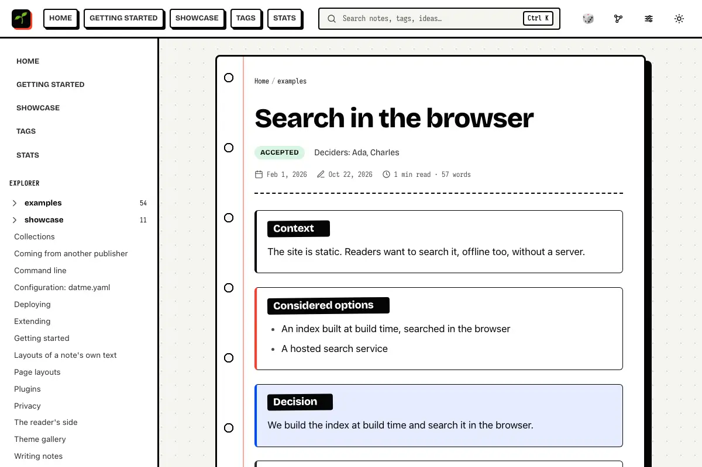

*Live example: [Search in the browser](examples/decision.md).*

## changelog

Each `##` heading is a version, with an optional date
(`## 1.2.0 - 2026-10-01`, `## [1.2.0] - 2026-10-01` or
`## v1.2.0 (2026-10-01)`), anchored at `#v1.2.0`. Keep a Changelog's `###`
sections (*Added*, *Changed*, *Deprecated*, *Removed*, *Fixed*, *Security*)
become coloured tags. The numbered versions also make an RSS feed at
`releases.xml` under the page, linked from it. It has no properties of its
own.

```markdown
---
layout: changelog
---

## [1.2.0] - 2026-10-01

### Added

- Dark mode.
```

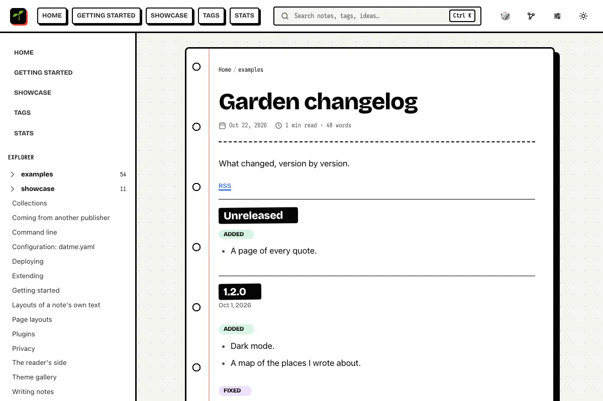

*Live example: [Garden changelog](examples/changelog.md).*

## dialogue

An interview, podcast notes or a play. Paragraphs that start with a speaker
(`**Ada:** …`, `**Ada**: …`, or `Ada: …` once the same name opens two
paragraphs) become chat bubbles, each speaker on a side and in a colour of
their own.

| Property | What it does |
| --- | --- |
| `speakers` | The names, or a map of name to picture: `speakers: { Ada: ada.jpg }` |

```markdown
---
layout: dialogue
speakers:
  Ada: "[[ada.jpg]]"
---

**Ada:** Why keep notes at all?

**Grace:** Because notes keep what I thought.
```

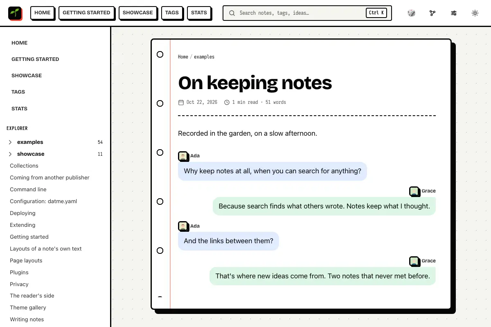

*Live example: [On keeping notes](examples/dialogue.md).*

## highlights

Reading notes as Readwise or a Kindle plugin exports them. Every quote and
every list item becomes a card, with its location (`(Location 123)`,
`(p. 45)`, `— location: 123`) and the note under it: the paragraphs right
after a quote, or what a list item nests. A *Metadata* section stays as it
is.

| Property | What it does |
| --- | --- |
| `cover`, `author` | The book in the head |
| `source` | A name, or a URL to link |

```markdown
---
layout: highlights
author: Sönke Ahrens
source: Kindle
cover: "[[smart-notes.jpg]]"
---

> Writing is not what follows research. (Location 123)

The whole book in one line.
```

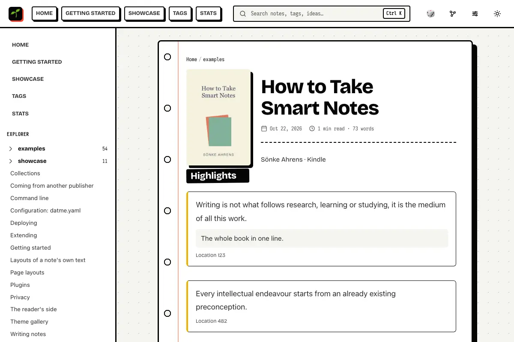

*Live example: [How to Take Smart Notes](examples/highlights.md).*

## glossary

Definitions A–Z. Each `##` or `###` heading, and each paragraph starting with
a term in bold (`**Term**: what it means`), is a term; a heading of a single
letter only groups them. A bar of letters jumps to each, and every term has
an anchor of its own. Notes tagged `type/term` that the page does not define
are listed too, with their `description`, linking to them (see
[Glossary](writing.md#glossary)). It has no properties of its own.

```markdown
---
layout: glossary
---

## Backlink

A link seen from the note it points to.

**Orphan**: a note no other note links to.
```

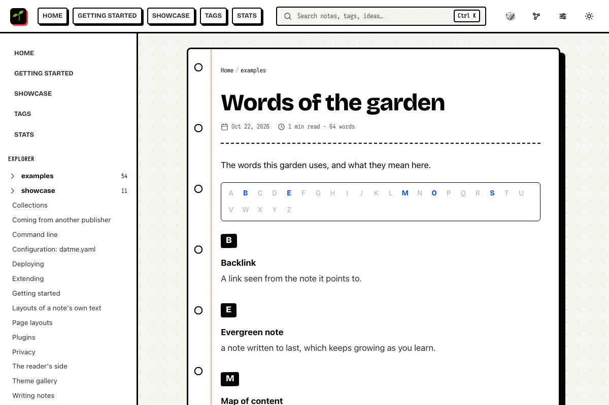

*Live example: [Words of the garden](examples/glossary.md).*

## trip

A travel journal. Each `##` heading is a day or a stop, numbered down the
page, with its pictures in a strip. A map at the top joins the places of
`route`, or else the stops: a stop is where a line of its own says
(`📍 35.01, 135.77`), or at the first note it links to that has a
`location`.

| Property | What it does |
| --- | --- |
| `route` | A list of notes with a `location`, `lat, lng` pairs, or `{ name, location }` |

```markdown
---
layout: trip
---

## Day 1 — Hà Nội

📍 21.03, 105.85

![[night-lake.jpg|The lake before we left]]
```

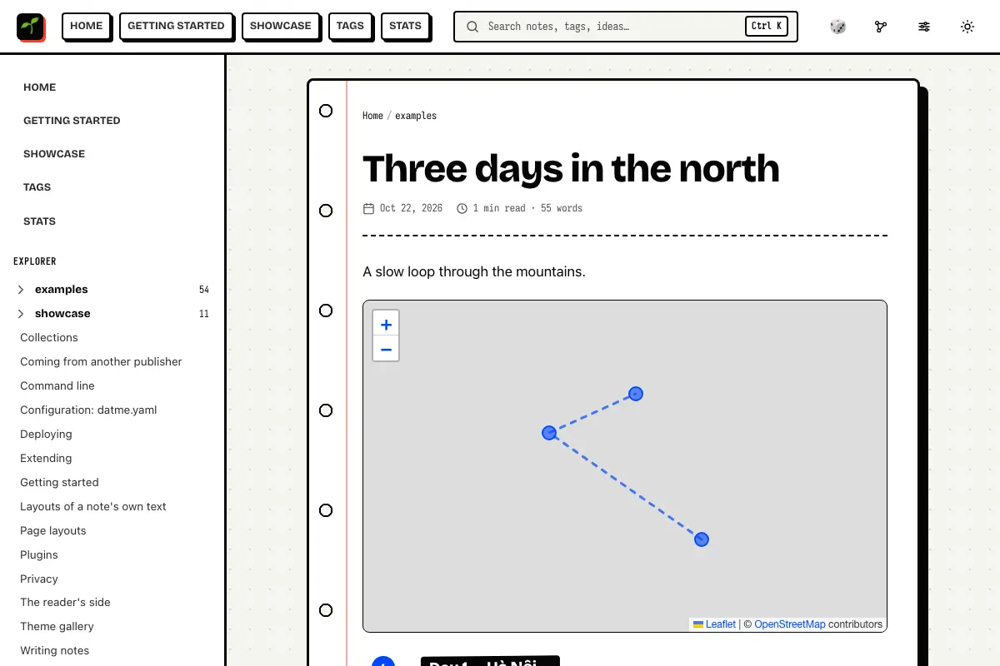

*Live example: [Three days in the north](examples/trip.md).*

## syllabus

A course. Each `##` heading is a lesson, numbered, with its reading time; a
note without them lists the notes of its [series](writing.md#series)
instead (the notes whose `series` links to it, or the series it names).
Readers tick lessons as done and see their progress; the ticks stay in their
browser. It has no properties of its own.

```markdown
---
layout: syllabus
---

## Planting

Write a note about one idea, in your own words.

## Linking

Link the new note to two notes you already have.
```

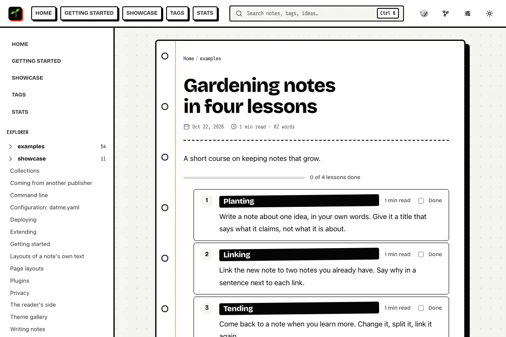

*Live example: [Gardening notes in four lessons](examples/syllabus.md).*

## poem

Verse, centred on the page, each line and its indentation kept as written.
The line breaks of `lineBreaks: true` come with the layout. With
[language blocks](writing.md#multilingual-notes), `bilingual: vi-VN` shows the
page's own text beside that language's, stanza by stanza, in two columns (one
under the other on a phone); the original, the note's `lang`, goes first, and
a block both share spans the two. On the page of that language itself, the
original goes beside it.

| Property | What it does |
| --- | --- |
| `numbered` | `true` numbers the stanzas in the margin |
| `bilingual` | The language whose translation goes beside the poem |
| `lineBreaks` | `false` joins lines again |

```markdown
---
layout: poem
numbered: true
---

The persimmons are ripe,
  the slip box full again;
a hundred small notes
  waiting for their links.
```

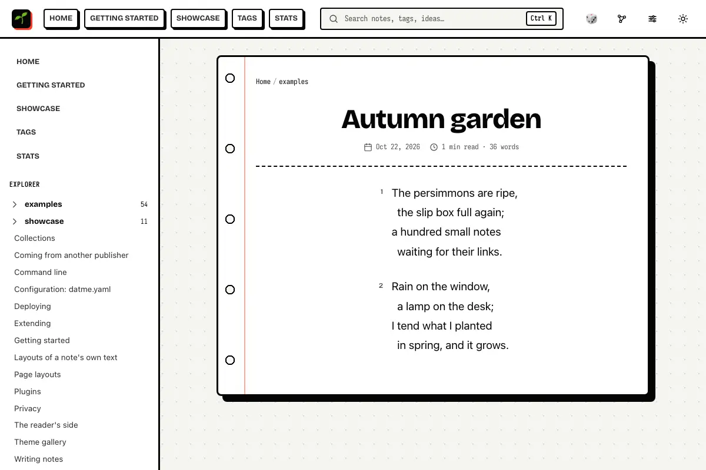

*Live example: [Autumn garden](examples/poem.md).*

## letter

A letter on a sheet of paper in the site's colours. The first paragraph is
the salutation. Without `signature`, the last line of the last paragraph is
the signature and the lines before it the closing (`Yours,` then `Ada`); a
last paragraph of one line follows a short one, six words at most, as the
closing. A letter always keeps a paragraph of body.

| Property | What it does |
| --- | --- |
| `place`, `date` | The line at the top right |
| `signature` | Signs it under the last paragraph, in words or as a picture of the vault (`signature: "[[signature.png]]"`, published like a cover, its ink turned light in dark mode) |

```markdown
---
layout: letter
place: Hà Nội
date: 2026-10-01
signature: Ada
---

Dear Ann,

The garden is doing well this autumn.

With love,
```

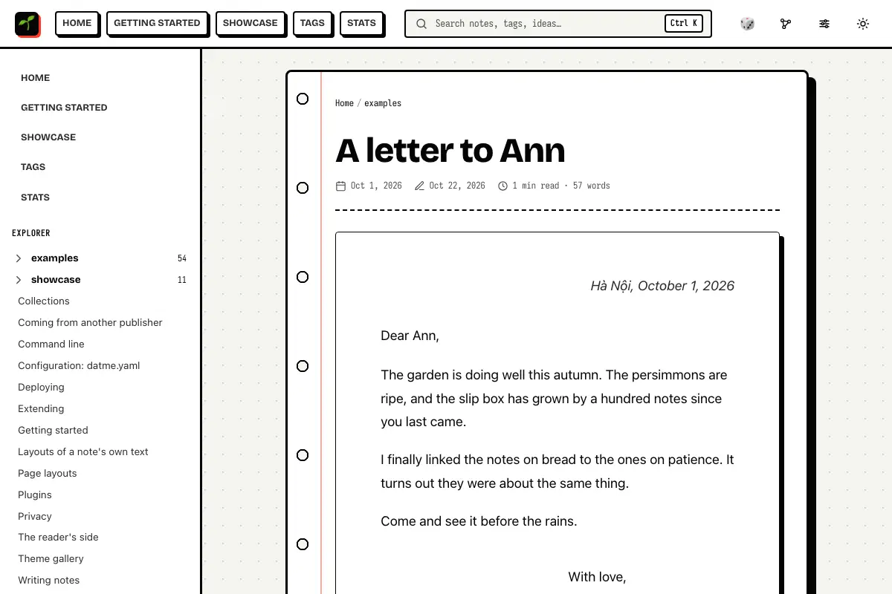

*Live example: [A letter to Ann](examples/letter.md).*

## compare

Options side by side. Each `##` heading is an option, a card of its own.
Items marked `✅` or `❌` (also `👍`, `👎`, `✔`, `✗`), items written with a
`+` marker (and `-` ones in the same list), and the lists under `### Pros`
and `### Cons` (*Advantages*, *Ưu điểm*, *Nachteile*…) become two columns,
for and against. Lines of `key: value` (a paragraph or a list of them,
`key:: value` too) fill a table of every option at the top, a dash where one
says nothing.

| Property | What it does |
| --- | --- |
| `pick` | An option's name: marks the one chosen, in its card and its column |

```markdown
---
layout: compare
pick: Obsidian
---

## Obsidian

- price: free

- ✅ Plain markdown
- ❌ Sync costs extra

## Notion

- price: from $10
```

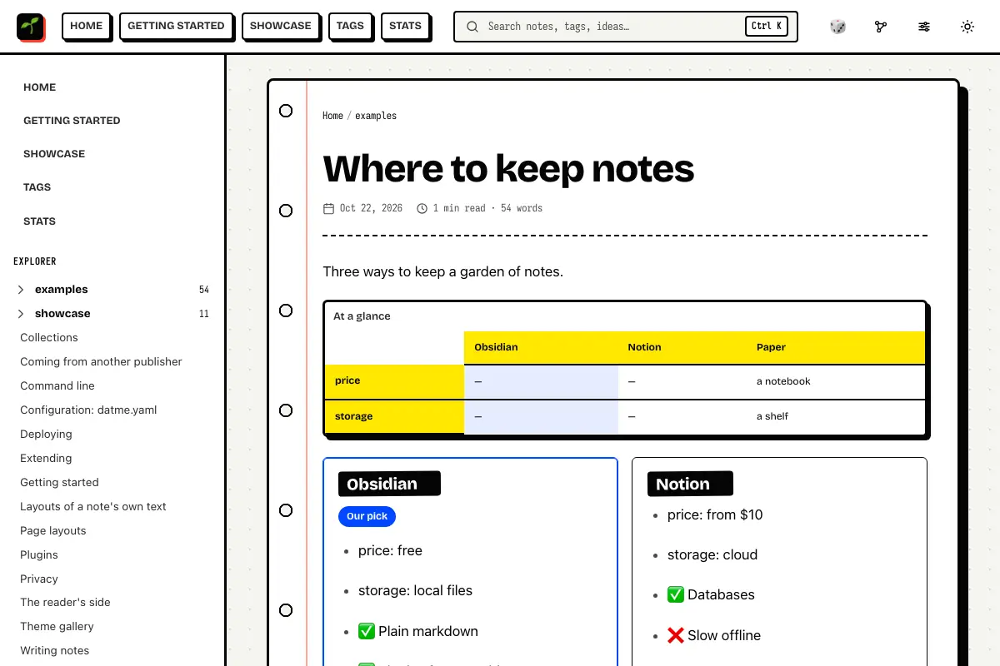

*Live example: [Where to keep notes](examples/compare.md).*

## checklist

Every task of the note (`- [ ] …`) becomes a box the reader ticks: a packing
list, a routine, a launch plan. The ticks stay in their browser for that
page; each `##` section counts its own, a bar the whole, and *Reset* goes
back to the boxes as the note ticks them. Tasks a query gathers from other
notes stay as they are, and so do the tasks of every other page. It has no
properties of its own.

```markdown
---
layout: checklist
---

## Clothes

- [ ] Raincoat
- [x] Boots
```

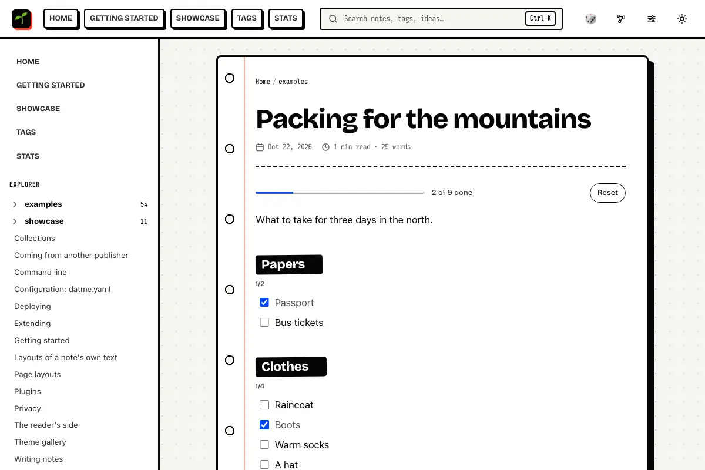

*Live example: [Packing for the mountains](examples/checklist.md).*

## recipe-card

One recipe as an index card the size of A6, lying down, with its ingredients
(a section named so) beside the steps, to tick off. *Print card* prints it
alone on one A6 card.

| Property | What it does |
| --- | --- |
| `cover` | The picture of the dish |
| `time`, `servings` | How long it takes, and for how many |

```markdown
---
layout: recipe-card
cover: "[[pancakes.jpg]]"
time: 20 min
servings: 4
---

## Ingredients

- 200 g flour

## Steps

1. Whisk everything until smooth.
```

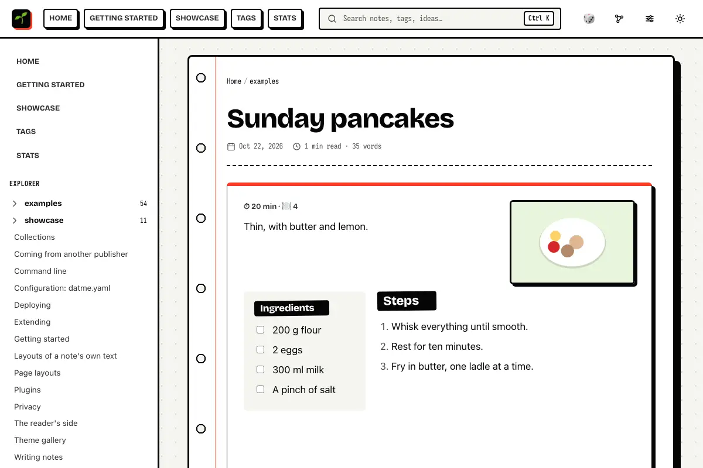

*Live example: [Sunday pancakes](examples/recipe-card.md).*

## hub

A map of content drawn round the note: its title in the centre, each `##`
section a spoke, and the links of each section leaves around it (eight at
most, the last counting the others). The map is drawn when the site is
built, as a picture for the eye; the sections follow as a list, which is
what screen readers, keyboards and paper get. A phone shows the list only.
It has no properties of its own.

```markdown
---
layout: hub
---

## Write

- [[writing|Writing notes]]
- [[layouts|Page layouts]]

## Publish

- [[deploying|Deploying]]
```

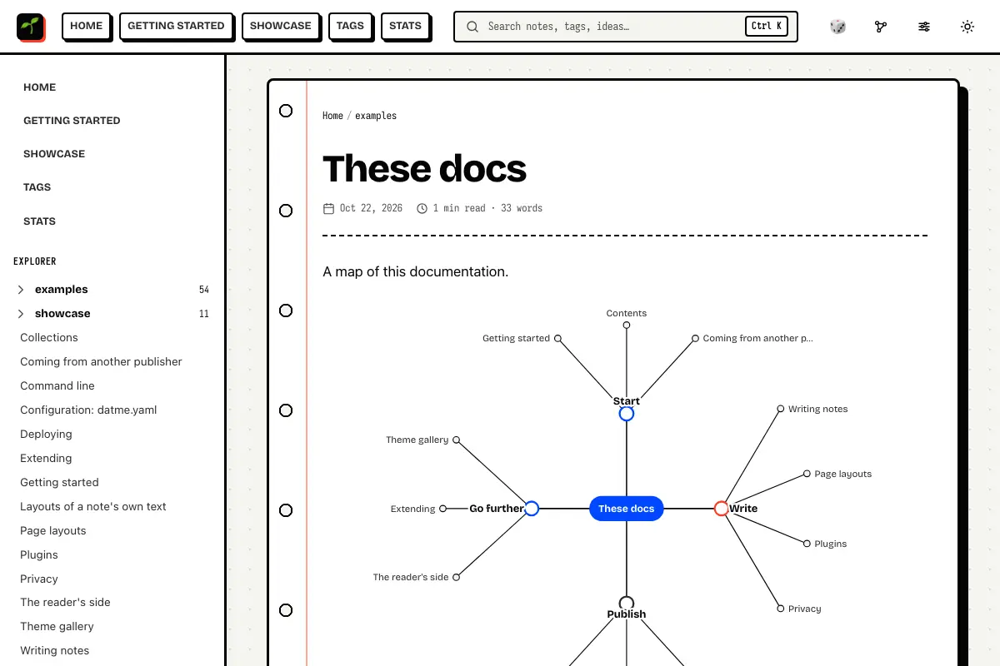

*Live example: [These docs](examples/hub.md).*

## lore

A character, place or faction of a world you are building. Its properties
are boxed beside its text, as in the `wiki` style, with its `cover`. The
relations are listed after the text, and parents, partners, siblings and
children (`parent`, `mother`, `spouse`, `sibling`, `child`, `cha`, `mẹ`,
`vợ`, `con`…) also make a small family tree. Then come the other `lore` notes
that name it, by relation (*child of Borin* when Borin says
`child: [[Aria]]`), and those that only link to it.

| Property | What it does |
| --- | --- |
| `cover` | The picture in the box |
| `relations` | Who it stands with, by relation: `{ parent: "[[Borin]]", ally: ["[[Cael]]", Mira] }`, or a list of `"ally: [[Cael]]"` |
| any other | Shown in the box |

```markdown
---
layout: lore
species: Elf
home: Silverwood
relations:
  parent: "[[Borin]]"
  sibling: Mira
---

Aria is a ranger of the Silverwood.
```

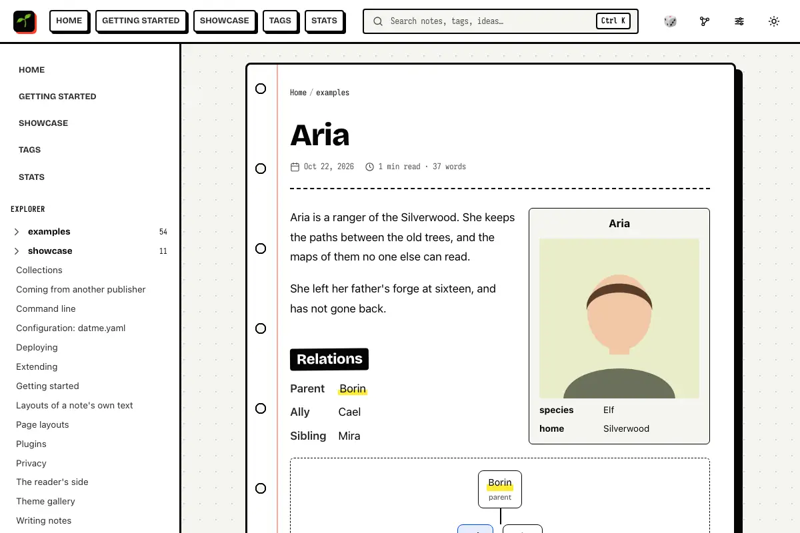

*Live example: [Aria](examples/lore.md).*

## Protected notes

A protected note keeps all of this inside its ciphertext: a poem's
translation, a letter's place and signature picture, the relations of lore
(on its own page and on the pages it names) are not published. See
[Privacy](privacy.md#password-protected-notes).
